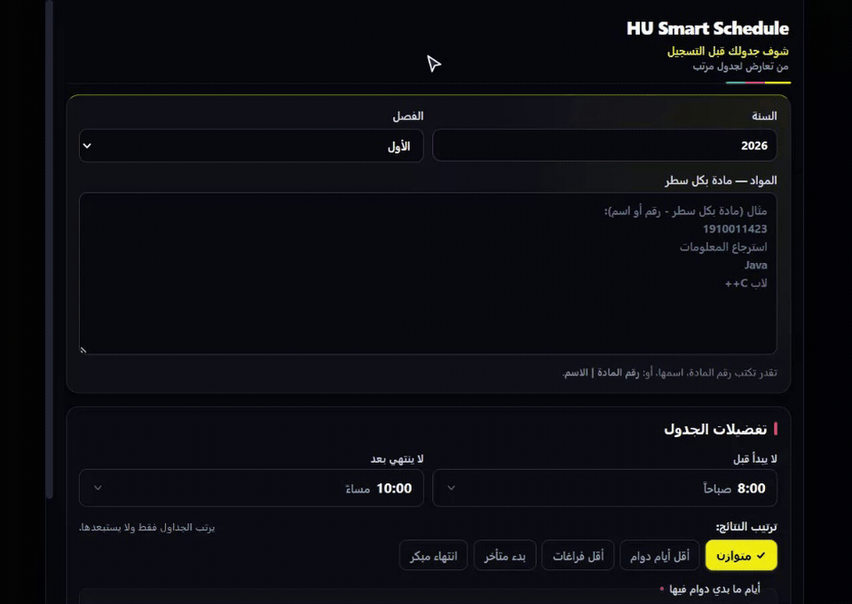
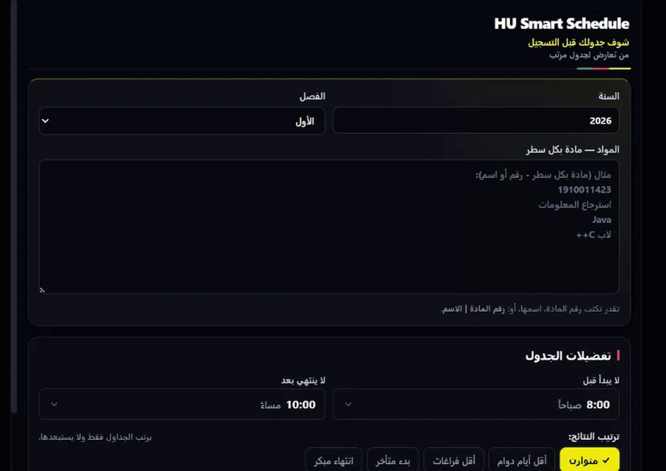
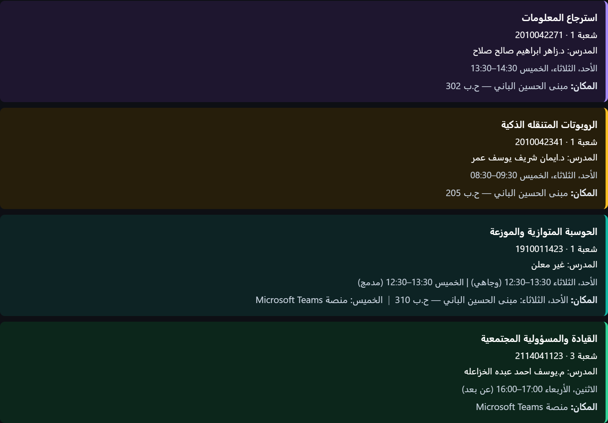
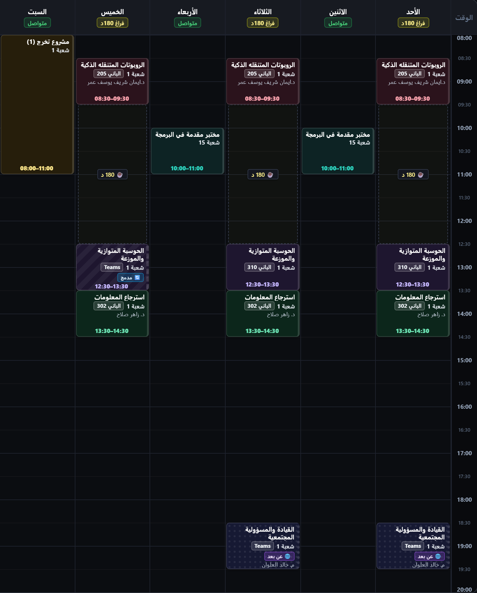
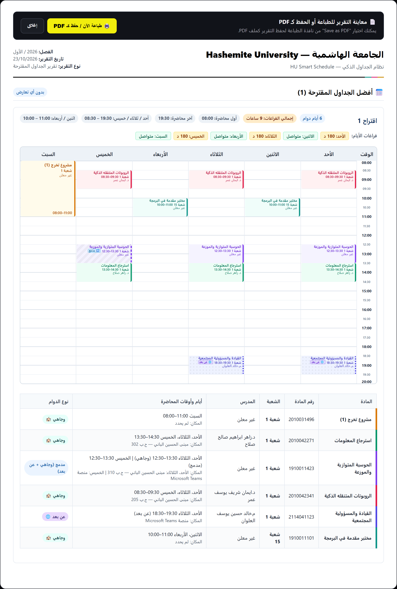
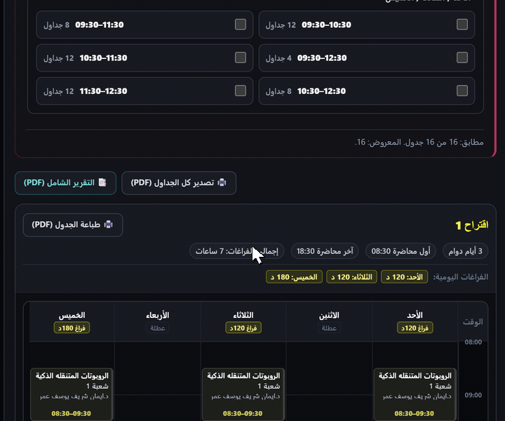
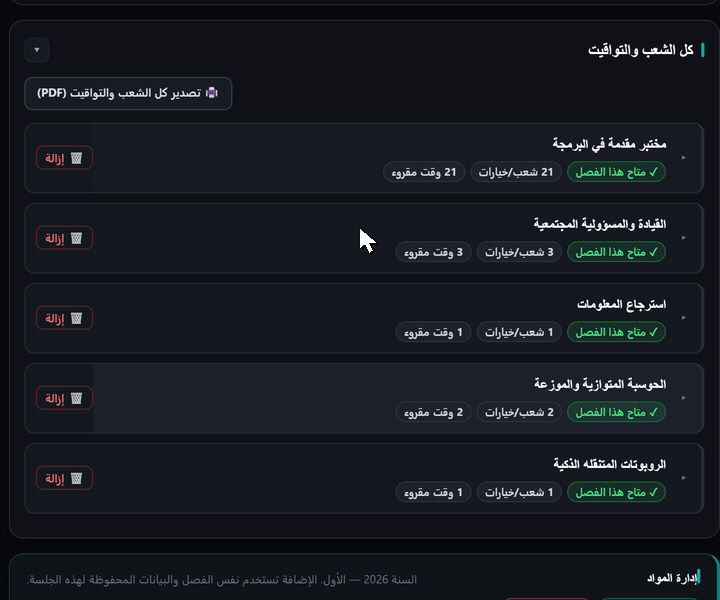

<!-- Release-Gated Draft: Pre-release offline draft for HU Smart Schedule v1.5.0. Pending formal release authorization. -->
# HU Smart Schedule

**Build smarter university schedules.**

A fast, privacy-first course schedule planner with automatic conflict detection, interactive manual building, classroom locations, flexible break preferences, and printable schedule reports — built for Hashemite University students.

  
  
  
  
  

> **Unofficial student tool.** HU Smart Schedule is not affiliated with or endorsed by Hashemite University.

---

#  English

## 🎬 Overview

HU Smart Schedule helps Hashemite University students plan their academic semester before registration opens. It fetches official public course-section data from the university portal and generates conflict-free weekly timetable proposals according to student preferences.

  

## ✨ Key Features

- 🔎 **Smart Multi-Attribute Search:** Lookup courses by numeric ID, official Arabic name, or common shorthand with interactive disambiguation.
- 🧩 **Interactive Manual Builder:** Hand-pick specific course sections with live timetable previews, conflict-aware disabled states, and deadlock guidance.
- 🏛️ **Classrooms & Delivery Modes:** Clear campus building codes and hall numbers (e.g., `ح.ب 302`, `الغربي 311`), plus blended (*مدمج*) and online lecture indicators.
- 📅 **Dynamic 6-Day Weekly Calendar:** Flexible scheduling from Saturday through Thursday, with automatic Saturday column activation and off-campus day badges.
- ⚠️ **Automated Conflict Detection:** Identifies overlapping lecture times across all sections and days automatically.
- ☕ **Break-Aware Scheduling & Ranking:** Choose preferred campus day combinations, target break intervals, and rank proposals by minimum days, minimal gaps, or time preferences.
- ➕ **Course Management & Local Drafts:** Add or remove courses seamlessly during planning sessions; saved drafts persist locally across sessions.
- 🖨️ **Printable PDF Schedule Reports:** Export an ink-friendly, A4-formatted schedule report with academic semester metadata, daily gap breakdown, and a complete section venue directory.
- 🔒 **Client-Side Privacy:** All schedule permutations and conflict calculations run 100% locally in your browser with zero analytics or backend tracking.

---

## 🔎 Smart Search

Enter course numbers, full Arabic course titles, or recognized English aliases. When a query matches multiple official offerings, an interactive disambiguation card allows immediate candidate selection.

  

- **Numeric Code:** Direct lookup by 6-to-10 digit university course numbers (e.g., `2010042271`).
- **Normalized Arabic Name:** Accents and common spelling variants are automatically normalized (e.g., `القيادة والمسؤولية المجتمعية`).
- **Supported Shorthand:** Quick lookup via English aliases (e.g., `parallel`, `algo`, `os`).
- **Interactive Disambiguation:** Displays matching candidate cards with department titles and course offering statuses. *(Note: Demonstration badges reflect fixture-backed course status).*

---

## 🧩 Interactive Manual Builder

Take complete manual control over section selection. Switch between **[توليد تلقائي]** (Automatic Generation) and **[بناء يدوي]** (Manual Builder) at any time.

  

- **Live Timetable Preview:** Selected sections immediately render into the weekly calendar block.
- **Intelligent Conflict Disabling:** Incompatible sections across all remaining courses are dynamically greyed out with explicit time-conflict badges.
- **Guidance & Deadlock Resolution:** If choices lead to zero compatible combinations, the builder provides actionable guidance to review conflicting sections or temporarily exclude a course to restore schedule viability.
- 🔍 *Deep Dive:* [View Deadlock Recovery Guidance Screenshot](docs/screenshots/v1.5/02_deadlock_recovery_card_with_review_btn.png)

---

## 🏛️ Classrooms & Delivery Modes

View verified lecture venues, building identifiers, and instructional modalities directly in the section cards, weekly calendar blocks, and PDF exports.

  

- **Campus Building & Room Codes:** Displays room labels from published Hashemite University course data, including `ح.ب 302` (**Al-Hussein Al-Bani Building**), `الغربي 311`, and `الباني 310`.
- **Blended Delivery (*مدمج*):** Highlights hybrid courses combining in-person campus lectures with remote sessions.
- **Online Meetings:** Clearly distinguishes remote evening or Microsoft Teams lectures without cluttering campus commute metrics.

---

## 📅 Dynamic 6-Day Weekly Calendar

The responsive weekly calendar adapts dynamically to student registration patterns, supporting Sunday through Thursday schedules as well as Saturday courses.

  

- **Adaptive Saturday Support:** The Saturday column automatically reveals itself when any selected or candidate section meets on Saturday. *(Note: The timetable above illustrates an example 6-day schedule demonstrating Saturday column activation and room labeling).*
- **Compact & Informative Blocks:** Displays course name, section number, instructor name, lecture time, and classroom code.
- **Off-Campus Indicators:** Flags fully free days as official off-campus days (*عطلة*).
- **Remote Evening Blocks:** Separate visual treatment for remote sessions (e.g., 18:30–19:30).

---

## 🖨️ Printable PDF Schedule Report

Generate a clean, high-resolution timetable export formatted specifically for standard A4 printing and digital archiving. The image below displays the browser-based print preview interface with campus metrics and section venue listings.

  

- **Ink-Friendly Layout:** High-contrast white background designed to minimize ink usage.
- **Academic Header & Statistics:** Displays university semester, total credit hours, total campus days, latest finish time, and daily break summaries.
- **Complete Venue Directory:** Includes a dedicated table listing each course, section, instructor, meeting days, lecture times, and campus hall venues.
- 📄 *Sample Document:* [Download Sample Timetable PDF (A4)](docs/screenshots/v1.5/schedule-saturday-export.pdf) *(Illustrative single-page exported timetable document generated by the extension)*.

---

## ☕ Break-Aware Scheduling & Preferences

Customize schedule ranking and break requirements to fit your daily campus routine:

  

Demo recorded with the v1.4 interface; the break-filtering feature remains available in v1.5.

- **STT Days (Sun / Tue / Thu):** 60-minute standard lecture blocks starting at 08:30.
- **MW Days (Mon / Wed):** 90-minute standard lecture blocks starting at 08:00.
- **Break Rules:** Break intervals are calculated strictly between consecutive **in-person** lectures on the same campus day. Remote evening sessions and free mornings/afternoons do not count as campus break time.
- **Ranking Priorities:** Sort generated proposals by minimum campus days, fewest total gap minutes, later start times, or earlier finish times.

---

## ➕ Course Management

Add or remove courses during planning without starting over. Keep your selected course list and preferences in a local draft while refining your schedule.

  

Demo recorded with the v1.4 interface; the course-management feature remains available in v1.5.

---

## 🚀 Quick Start

1. Open the extension popup or standalone tab.
2. Enter your desired course numbers, names, or aliases into the search field.
3. Select preferred class days, start/end time boundaries, and ranking preferences.
4. Click **[بحث عن المواد والشعب]** to fetch official section data.
5. Browse automatically generated schedule proposals, or switch to **[بناء يدوي]** to build your own.
6. Click **[تصدير الجدول (PDF)]** to print or save your final timetable.

---

## 📦 Installation

HU Smart Schedule is distributed as a lightweight Chrome extension (Manifest V3).

### Manual Installation on Google Chrome

1. Download the latest available release package from [GitHub Releases](https://github.com/md3ja/HU-Smart-Schedule-Extension/releases).
2. Extract the downloaded release ZIP file on your computer.
3. Open Google Chrome and navigate to `chrome://extensions/`.
4. Enable **Developer mode** using the toggle switch in the top right corner.
5. Click **Load unpacked** in the top left corner.
6. Select the extracted folder containing `manifest.json`.
7. Pin **HU Smart Schedule** to your Chrome toolbar for quick access during registration planning.

> **Note for developers:** If cloning this repository directly via git, select the root repository directory (where `manifest.json` resides) when clicking **Load unpacked**.

---

## 🔒 Privacy & Permissions

HU Smart Schedule is built with strict student privacy principles:

- **No Backend Server:** The extension contains zero backend servers, analytics endpoints, or telemetry collection.
- **Client-Side Processing:** Schedule permutation, conflict analysis, ranking, and PDF generation occur entirely within your browser.
- **Local Storage Only:** The `storage` permission is used strictly on your device to remember course drafts and preference settings.
- **Narrow Host Permission (`https://hu.edu.jo/*`):** Used exclusively to fetch public course schedule tables directly from the Hashemite University portal during active searches.

For complete details, see [PRIVACY.md](PRIVACY.md).

---

## 🛠️ Technical Details

- **Platform:** Google Chrome Extension (Chromium)
- **Manifest:** Manifest V3
- **Frontend:** Semantic HTML5, CSS3, Modern JavaScript (ES2022)
- **Layout & Typography:** Native Arabic RTL interface with responsive design
- **State Engine:** In-memory schedule generator and validator with CSP compliance
- **Data Source:** Hashemite University public course section portal
- **Required Host Permission:** `https://hu.edu.jo/*`
- **External Dependencies:** Zero runtime framework dependencies

---

## 🆕 Current Release

**Current Version:** `v1.5.0`

### Key Additions & Enhancements

- 🧩 **Interactive Manual Builder:** Direct section-by-section selection with live timetable synchronization and conflict-aware guidance.
- 🏛️ **Stage 2B Classroom & Room Parsing:** Support for campus buildings, lecture halls, and blended (*مدمج*) attendance badges.
- 📅 **Dynamic 6-Day Weekly Calendar:** Integrated Saturday scheduling column with automatic visibility toggles.
- 🔎 **Smart Multi-Attribute Search:** Interactive candidate disambiguation modal for partial queries and course availability badges.
- 🖨️ **Enhanced PDF Export:** Updated A4 print layout featuring verified campus venue directories and accurate daily gap statistics.
- ⚡ **Performance & Stability:** Zero-flicker calendar rendering and optimized memory handling for large section combinations.

Release history and tags: [GitHub Releases](https://github.com/md3ja/HU-Smart-Schedule-Extension/releases)

---

## 📜 License & Usage

© 2026 HU Smart Schedule. **All rights reserved.**

This project is proprietary and not open-source. Copying, redistributing, modifying, or using the code or project assets commercially without prior authorization is strictly prohibited.

---

#  العربية

## 🎬 نظرة عامة

**HU Smart Schedule** أداة طلابية مصممة لمساعدة طلبة الجامعة الهاشمية على تخطيط جداولهم الدراسية بدقة وسهولة قبل بدء فترة التسجيل الرسمية. تقوم الإضافة بجلب بيانات الشعب المعلنة من بوابة الجامعة وتوليد جداول أسبوعية خالية من التعارضات وفق تفضيلات الطالب.

  

## ✨ أهم المميزات

- 🔎 **البحث الذكي متعدد المعايير:** البحث برقم المادة أو اسمها العربي المعتمد أو اختصاراتها الشائعة مع نافذة تحديد المادة عند تشابه الأسماء.
- 🧩 **البناء اليدوي التفاعلي للجدول:** اختيار شعب المواد شعبة تلو الأخرى مع معاينة حية ومباشرة للتقويم، وتعطيل الشعب المتعارضة تلقائياً.
- 🏛️ **القاعات الدراسية وأنماط التدريس:** إظهار مباني الحرم الجامعي والقاعات (مثل `ح.ب 302` و`الغربي 311`) وشارات المحاضرات المدمجة والوجاهية والإلكترونية.
- 📅 **الجدول الأسبوعي المرن (6 أيام):** دعم كامل لأيام الدوام من السبت إلى الخميس، مع إظهار تلقائي لعمود يوم السبت عند وجود شعب فيه.
- ⚠️ **كشف التعارضات التلقائي:** فحص التداخلات الزمنية بين كافة المحاضرات والشعب بدقة لحظية.
- ☕ **تنظيم الاستراحات وتفضيلات الترتيب:** تحديد فترات Break المطلوبة وترتيب المقترحات حسب أقل أيام دوام أو أقل فراغات أو أوقات البداية والنهاية.
- ➕ **إدارة المواد وحفظ المسودة:** إضافة أو حذف مواد أثناء نفس جلسة التخطيط دون فقدان المدخلات، مع حفظ تلقائي للمسودة محلياً.
- 🖨️ **تصدير وطباعة تقرير PDF:** طباعة الجدول أو تصديره بصيغة PDF بتصميم A4 واضح وموفر للحبر يتضمن إحصائيات الدوام ودليل القاعات.
- 🔒 **خصوصية محلية كاملة:** كافة معالجات الجداول وفحص التعارضات تتم محلياً بنسبة 100% داخل المتصفح دون خوادم خلفية أو تتبع.

---

## 🔎 البحث الذكي عن المواد

يتيح محرك البحث إدخال أرقام المواد، أو أسمائها العربية الكاملة، أو اختصاراتها بالإنجليزية. وعند مطابقة البحث لأكثر من مادة رسمية، تظهر نافذة تفاعلية تتيح اختيار المادة المقصودة مباشرة.

  

- **البحث برقم المادة:** إدخال رقم المادة الجامعي المكون من 6 إلى 10 أرقام (مثل `2010042271`).
- **البحث بالاسم العربي:** دعم المعالجة الموحدة للأحرف والهمزات (مثل `القيادة والمسؤولية المجتمعية`).
- **البحث بالاختصارات:** دعم الكلمات المفتاحية الإنجليزية للمواد (مثل `parallel` و`algo` و`os`).
- **نافذة تحديد المادة:** استعراض بطاقات المواد المطابقة مع أسماء الكليات والأقسام وحالة طرح المادة في الفصل. *(ملاحظة: شارات العرض في النموذج التوضيحي تستند لبيانات مسجلة مسبقاً).*

---

## 🧩 البناء اليدوي التفاعلي للجدول

إمكانية التحكم الكامل في اختيار الشعب؛ حيث يمكن التبديل بسلاسة بين وضع **[توليد تلقائي]** ووضع **[بناء يدوي]** في أي لحظة.

  

- **معاينة تقويم حية:** الشعبة المختارة تظهر فوراً في جدول الأسبوع.
- **تعطيل ذكي للشعب المتعارضة:** يتم تظليل الشعب التي تتعارض مع اختياراتك السابقة باللون الرمادي مع بيان سبب التعارض بدقة.
- **إرشادات حل التعارض وحالات الانغلاق:** في حال أدت الاختيارات لعدم وجود أي شعب متوافقة للمادة المتبقية، توفر الإضافة زراً لإعادة مراجعة الشعب أو استبعاد المادة مؤقتاً لاستكمال الجدول.
- 🔍 *تفاصيل إضافية:* [استعراض بطاقة إرشادات حل الانغلاق](docs/screenshots/v1.5/02_deadlock_recovery_card_with_review_btn.png)

---

## 🏛️ القاعات الدراسية وأنماط التدريس

توضيح دقيق لأماكن المحاضرات والمجمعات والقاعات الدراسية ونمط الحضور داخل بطاقات الشعب والتقويم الأسبوعي وملف الطباعة.

  

- **رموز المباني والقاعات:** عرض المواقع كما وردت في بيانات الجامعة الهاشمية، مثل `ح.ب 302` (**مبنى الحسين الباني**)، و`الغربي 311`، و`الباني 310`.
- **التعليم المدمج (*مدمج*):** شارة تميز المواد التي تجمع بين محاضرات وجاهية ومحاضرات عن بُعد.
- **المحاضرات الإلكترونية:** تمييز واضح للمحاضرات المسائية أو محاضرات Microsoft Teams عن المحاضرات الوجاهية.

---

## 📅 الجدول الأسبوعي المرن (6 أيام)

تقويم أسبوعي متجاوب يعرض جدولك من الأحد إلى الخميس، أو من السبت إلى الخميس تلقائياً عند تسجيل مادة تطرح يوم السبت.

  

- **دعم يوم السبت التلقائي:** يظهر عمود يوم السبت تلقائياً عند اختيار شعبة تحتوي على موعد سبت دون التأثير على الجداول العادية. *(ملاحظة: الجدول المعروض هو نموذج توضيحي يبين تفعيل عمود السبت وتوزيع القاعات في التقويم الممتد لستة أيام).*
- **بطاقات المحاضرات الواضحة:** إظهار اسم المادة، رقم الشعبة، المدرس، توقيت المحاضرة، وقاعتها.
- **شارات أيام العطلة:** تمييز الأيام الخالية تماماً من المحاضرات الوجاهية كيوم عطلة (*عطلة*).
- **المحاضرات المسائية:** بطاقات خاصة للمحاضرات التي تعقد في فترات المساء (مثل 18:30–19:30).

---

## 🖨️ تصدير وطباعة تقرير PDF

تصدير تقرير جدول دراسي احترافي بحجم A4 مخصص للطباعة الورقية أو الحفظ الرقمي بتصميم موفر للحبر. تعرض الصورة أدناه واجهة معاينة الطباعة داخل المتصفح مع الإحصائيات ودليل القاعات.

  

- **تصميم أبيض مريح وموفر للحبر:** خلفية بيضاء وخطوط عربية عالية التباين لضمان أعلى جودة طباعة.
- **بيانات الفصل والإحصائيات:** عرض الفصل الدراسي، مجموع الساعات، أيام الدوام، موعد نهاية آخر محاضرة، وإجمالي الاستراحات اليومية.
- **دليل تفصيلي للقاعات والشعب:** جدول مفصل بأسماء المواد والمدرسين والشعب والأيام ومواعيد وقاعات المحاضرات.
- 📄 *نموذج المستند:* [تحميل نموذج تقرير PDF للجدول (A4)](docs/screenshots/v1.5/schedule-saturday-export.pdf) *(مستند توضيحي من صفحة واحدة صادر عن أداة التصدير في الإضافة)*.

---

## ☕ تنظيم الاستراحات وتفضيلات الترتيب

تحكم دقيق في ترتيب اقتراحات الجداول وفترات Break اليومية:

  

تم تسجيل العرض على واجهة v1.4، وميزة فلترة الاستراحات ما زالت متوفرة في v1.5.

- **أيام الأحد / الثلاثاء / الخميس (STT):** فترات مدتها 60 دقيقة تبدأ من 08:30.
- **أيام الاثنين / الأربعاء (MW):** فترات مدتها 90 دقيقة تبدأ من 08:00.
- **قواعد احتساب Break:** تُحسب الاستراحة فقط كفترة فراغ بين محاضرتين **وجاهيتين** متتاليتين في نفس اليوم داخل الحرم الجامعي. المحاضرات عن بُعد وأوقات الفراغ الصباحية أو المسائية لا تُحتسب كفترات Break.
- **معايير الترتيب:** ترتيب المقترحات تلقائياً حسب أقل أيام دوام، أو أقل دقائق فراغ، أو أوقات البداية المتأخرة، أو أوقات الانتهاء المبكرة.

---

## ➕ إدارة المواد

يمكنك إضافة المواد أو حذفها أثناء التخطيط للجدول دون البدء من جديد، مع حفظ قائمة المواد والتفضيلات في مسودة محلية.

  

تم تسجيل العرض على واجهة v1.4، وميزة إدارة المواد ما زالت متوفرة في v1.5.

---

## 🚀 طريقة الاستخدام

1. افتح الإضافة من شريط المتصفح (نافذة منبثقة أو نافذة كاملة).
2. اكتب أرقام أو أسماء المواد في حقل البحث.
3. حدد تفضيلاتك: الأيام المفضلة، أوقات البداية والنهاية، وطريقة الترتيب.
4. اضغط على **[بحث عن المواد والشعب]** لجلب بيانات الشعب من بوابة الجامعة.
5. استعرض مقترحات الجداول المتولدة تلقائياً، أو انتقل إلى تبويب **[بناء يدوي]** لاختيار الشعب بنفسك.
6. اضغط على **[تصدير الجدول (PDF)]** لطباعة جدولك أو حفظه كملف PDF.

---

## 📦 التثبيت

تتوفر HU Smart Schedule كإضافة لمتصفح Google Chrome (وفق معيار Manifest V3).

### التثبيت اليدوي على Google Chrome

1. حمّل أحدث حزمة إصدار متاحة من [GitHub Releases](https://github.com/md3ja/HU-Smart-Schedule-Extension/releases).
2. فك ضغط ملف الإصدار (ZIP) على جهازك.
3. افتح متصفح Chrome وتوجه إلى `chrome://extensions/`.
4. فعّل **وضع مطوّر البرامج (Developer mode)** من الزاوية العلوية.
5. اضغط على زر **تحميل إضافة تم فك حزمتها (Load unpacked)**.
6. اختر المجلد الناتج عن فك الضغط (الذي يحتوي مباشرة على ملف `manifest.json`).
7. يمكنك تثبيت أيقونة **HU Smart Schedule** في شريط الأدوات للوصول السريع إليها أثناء التخطيط.

> **ملاحظة للمطورين:** في حال استنساخ المستودع مباشرة عبر Git، اختر المجلد الرئيسي للمستودع (حيث يوجد ملف `manifest.json`) عند الضغط على **Load unpacked**.

---

## 🔒 الخصوصية والصلاحيات

صُممت HU Smart Schedule وفق أعلى معايير احترام خصوصية الطلبة:

- **لا يوجد خادم خلفي (Backend):** الإضافة لا تتصل بأي خوادم خارجية خاصة أو أدوات تتبع أو تحليلات.
- **معالجة محلية للجداول:** يتم توليد الجداول وفحص التعارضات والترتيب والطباعة داخل متصفحك مباشرة.
- **تخزين محلي:** تُستخدم صلاحية `storage` حصرياً على جهازك لحفظ مسودة المواد والتفضيلات بين الجلسات.
- **صلاحية النطاق (`https://hu.edu.jo/*`):** تُستخدم فقط للاتصال المباشر ببوابة الجامعة العامة لجلب بيانات الشعب أثناء البحث.

للمزيد من التفاصيل، راجع [PRIVACY.md](PRIVACY.md).

---

## 🛠️ التفاصيل التقنية

- **المنصة:** إضافة متصفح Google Chrome (Chromium)
- **Manifest:** Manifest V3
- **الواجهة:** HTML5 الدلالي، CSS3، وجافاسكريبت الحديثة (ES2022)
- **التخطيط:** واجهة عربية أصيلة من اليمين إلى اليسار (RTL) متجاوبة
- **محرك الحسابات:** خوارزميات توليد وفحص تعارضات محلية متوافقة مع سياسة أمان المحتوى (CSP)
- **مصدر البيانات:** بوابة الشعب العامة للجامعة الهاشمية
- **صلاحية الموقع:** `https://hu.edu.jo/*`
- **الاعتماديات:** بدون أي أطر عمل خارجية (Vanilla Web Standards)

---

## 🆕 الإصدار الحالي

**الإصدار:** `v1.5.0`

### أبرز التحديثات في هذا الإصدار

- 🧩 **البناء اليدوي التفاعلي:** اختيار الشعب يدوياً خطوة بخطوة مع مزامنة لحظية للتقويم وإرشادات التعارض.
- 🏛️ **دعم القاعات والمباني (Stage 2B):** إظهار قاعات المحاضرات والمجمعات وشارات التعليم المدمج (*مدمج*).
- 📅 **الجدول الأسبوعي المرن (6 أيام):** دعم دوام يوم السبت مع تفعيل تلقائي للعمود عند الحاجة.
- 🔎 **البحث الذكي المتطور:** نافذة تفاعلية لحل تشابه أسماء المواد وإظهار شارة طرح المادة في الفصل.
- 🖨️ **تطوير تقرير PDF للطباعة:** تنسيق طباعة A4 محسن مع دليل القاعات وإحصائيات الاستراحات المطابقة.
- ⚡ **تحسينات الأداء:** ثبات بصري كامل للتقويم وسرعة فائقة في معالجة آلاف التباديل الممكنة.

سجل الإصدارات: [GitHub Releases](https://github.com/md3ja/HU-Smart-Schedule-Extension/releases)

---

## 📜 الترخيص وحقوق الاستخدام

© 2026 HU Smart Schedule. **جميع الحقوق محفوظة.**

هذا المشروع مملوك وليس مفتوح المصدر. يُحظر نسخ أو إعادة توزيع أو تعديل أو استخدام الشيفرة المصدرية أو أصول المشروع لأغراض تجارية دون إذن خطي مسبق.

---

  Built for Hashemite University students — صُممت لطلبة الجامعة الهاشمية

